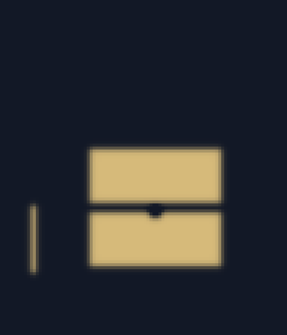
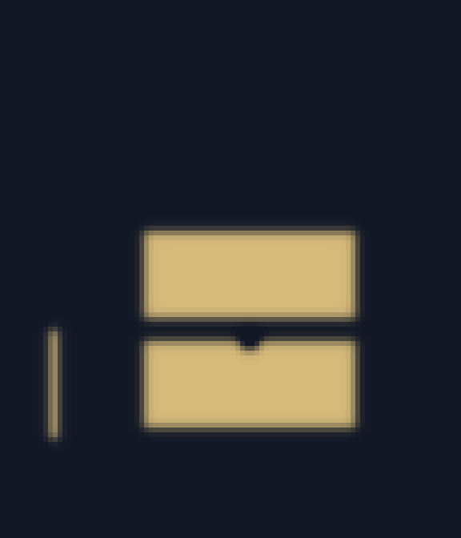
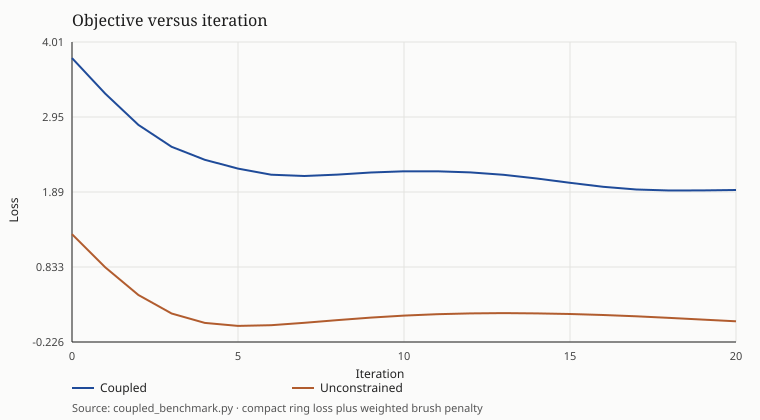
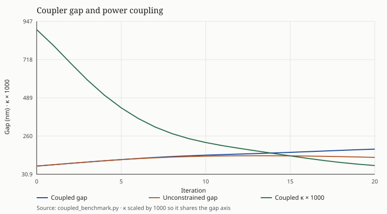
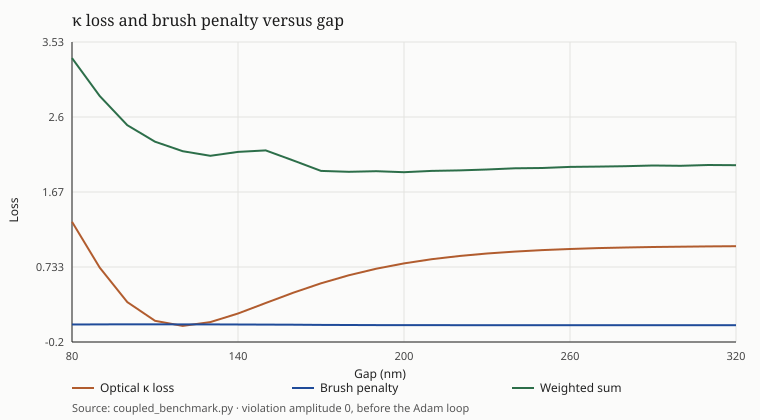

# Coupled inverse-design benchmark

Inverse design, foundry brushes, and the silicon Lorentz pole run in one loop.
The compact ring model supplies loaded Q, extinction, and κ. The brush penalty
is inside the gap update. Each recorded design calls the same Lorentz pole from
FDFD and from the FDTD auxiliary update.

## Unit tests

Ran `test_inverse.py`, `test_mfs_brush.py`, and `test_dispersive_resonance.py` before the coupled loop.
25 tests, all passed, 0.478 s in the unittest timer (0.747 s wall clock).

## Setup

- Foundry minimum feature 150 nm. Grid 25 nm. Circular brush radius 3 px, enforced width 150 nm. Notch cut 25 nm. Brush smoothing β = 8.
- Coupler length locked at 4 μm and ring radius locked at 10 μm, so the gap is the coupling knob. κ target 0.42. That target sits near a 120 nm gap, which is below the foundry rule.
- Start: gap 80 nm, violation amplitude 1 (a 36 nm rib and a 90 nm sidewall notch).
- Brush weight 111.110, chosen so the gap sweep's minimum of optical loss plus the weighted penalty is at 200 nm.
- Adam gap step 0.018 in scaled coordinates (about 8.1 nm). The weighted loss has a ridge between the κ well near 120 nm and the foundry basin near 180 nm, so the gap step is allowed to climb it. Violation amplitude step 0.14, accepted only when it lowers the loss. 20 iterations.

## Convergence

Coupled loop: loss 3.7822 → 1.9199.
Lowest loss is 1.9129 at iteration 18.
90% of the drop from the start to that lowest loss is in hand at iteration 14 (6.83 s).
Wall time 9.66 s, of which the Lorentz pair averages 111 ms per call.

Unconstrained loop (brush weight 0): lowest loss 0.0010 at iteration 5 (1.51 s), endpoint loss 0.0669. Wall time 5.59 s.
The table below uses the lowest-loss iterate of each arm. Histories are in `coupled_benchmark.json`.

## Sensor metrics and fabrication

| Metric | Initial | Coupled selected | Unconstrained selected |
| --- | ---: | ---: | ---: |
| Gap (nm) | 80.00 | 174.32 | 118.56 |
| Violation amplitude | 1 | 0.02 | 1 |
| κ | 0.898 | 0.101 | 0.433 |
| κ error | 0.478 | 0.319 | 0.013 |
| Loaded Q | 462.00 | 10160 | 1949 |
| Extinction (dB) | 0.0185 | 0.489 | 0.0908 |
| Circular width penalty | 0.00372 | 0.00254 | 0.00371 |
| Circular gap penalty | 0.00656 | 0.00289 | 0.00619 |
| Notch penalty | 0.0121 | 0.00661 | 0.013 |
| Total brush penalty | 0.0224 | 0.012 | 0.0229 |

Sub-resolution rib and notch penalized: yes.
Width penalty 0.0037 → 0.0025, notch 0.0121 → 0.0066, amplitude 1.00 → 0.02.
With the rib and notch removed, the sweep near 170 nm has width penalty 0.0025 and notch penalty 0.0070. That floor is the smooth edge of the legal guides.
Illegal gap penalized: yes.
Gap penalty 0.0066 → 0.0029. Coupled gap 174.3 nm (meets 150 nm). Unconstrained gap 118.6 nm (misses 150 nm).

Tradeoff against the unconstrained κ match: opening the gap to satisfy the brush
moves κ from 0.433 to 0.101 (target 0.42).
Loaded Q goes from 1949 to 10160 because the ring is less strongly coupled.
Extinction goes from 0.09 dB to 0.49 dB.
Both designs stay over-coupled relative to the ring's round-trip loss, so the extinction stays low; critical coupling on this 4 μm coupler wants a still wider gap.

## Lorentz pole across both solvers

The cavity is a silicon block on the same 16×12 mesh the dispersion unit test uses.
Its resonance is not the ring resonance. The check is that one catalog pole
(`si`, Δε = 4.31, ω0 = 6.020e+15 rad/s)
produces the same complex root in both solvers while the optimizer is moving.

- FDFD Q 5399.8, FDTD corrected Q 5405.0, mean relative difference 9.696e-04 (max 9.696e-04).
- Mean relative wavelength difference 1.181e-06. Worst FDTD fit residual 1.337e-07.
- Live FDFD wavelength is 3.86 nm longer than the cavity whose permittivity is frozen at ω = 0.
- At the ring resonance (1550.25 nm) the same pole gives ε = 12.2610 + 0.0071 i.
- 21 calls on the coupled arm, mean 111 ms, sum 2.34 s.

## Layouts

Gold is silicon, navy is void. Propagation is horizontal and the coupler gap is the vertical opening. The rib is the short vertical mark on the left.

## Files

- `coupled_benchmark.json` — full histories, the gap sweep, and the Lorentz records
- `history.csv` — one row per iteration of each arm

Reproduce with `backend/.venv/bin/python coupled_benchmark.py` from `backend`.
